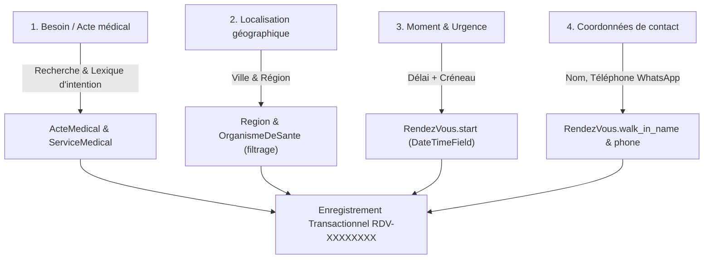

# 📚 Référentiels des 6 Piliers, Lexique d'Intention & Chatbot 4 Questions MedCare

Ce document synthétise l'ensemble des travaux réalisés pour l'intégration des 6 piliers médicaux, l'export JSON, le lexique d'intention et le système de collecte de données par chatbot en 4 questions.

---

## 1. Référentiels des 6 Piliers MedCare (Export JSON)

Les 6 référentiels sources au format HTML situés dans `documents/referentiel/` ont été parsés et exportés en JSON standardisés :

| Pilier | Fichier HTML Source | Données Exportées | Mode Particulier | Fichier JSON Exporté |
| :--- | :--- | :---: | :---: | :--- |
| **1. 🧬 Biologie médicale** | `Referentiel_Biologie_MedCare (1).html` | 415 actes | Référentiel complet | `biologie_medicale.json` |
| **2. 🖥 Imagerie médicale** | `Referentiel_Imagerie_MedCare.html` | 220 actes | Référentiel complet | `imagerie_medicale.json` |
| **3. ⚡ Explorations fonctionnelles** | `Referentiel_Explorations_MedCare.html` | 136 actes | Référentiel complet | `explorations_fonctionnelles.json` |
| **4. 🚑 Ambulance médicalisée** | `Referentiel_Ambulance_MedCare.html` | **40 intentions** | **Lexique d'intention UNIQUEMENT** | `ambulance_medicalisee.json` |
| **5. 🩺 Soins spécialisés** | `Referentiel_Soins_Specialises_MedCare.html` | 100 actes | Référentiel complet | `soins_specialises.json` |
| **6. 🦷 Soins dentaires** | `Referentiel_Dentaire_MedCare.html` | 103 actes | Référentiel complet | `soins_dentaires.json` |

> ⚠️ **Consigne stricte respectée pour le Pilier 4 (Ambulance médicalisée) :**
> Conformément à vos instructions (*« JUSTE UTILISER LE LEXIQUE D'INTENTION. Le Catalogue des ambulances est déjà bien comme il est actuellement sur la plateforme »*), aucun acte n'a été inséré ou modifié pour l'ambulance. Seul le **lexique d'intention** (40 intentions de transport et leurs variantes réelles) a été exporté et exploité pour l'orientation.

### Fichiers Exports Disponibles :
- **Master combiné 6 piliers :** `referentiel_6piliers_medcare.json`
- **Lexique d'intention global :** `lexique_intention_medcare.json` (2 890 variantes et synonymes)
- **Exports individuels :** dossier `documents/referentiel/exports_json/`

---

## 2. Mise à Jour du Catalogue d'Actes (Complément en Base de Données)

La base de données Django (`ActeMedical` et `ServiceMedical`) a été enrichie avec les actes manquants du référentiel :

- **Nouvelles catégories créées (Niveau 2) :** `+40` catégories
- **Nouveaux actes spécifiques créés (Niveau 3) :** `+506` actes
- **Total actes Niveau 3 en base de données :** **`1 583 actes`**
- **Ambulance médicalisée :** Aucun acte ajouté (catalogue plateforme inchangé).

---

## 3. Le Lexique d'Intention MedCare

Le lexique d'intention permet de convertir automatiquement les formulations libres des patients ou structures vers les actes et piliers officiels.

- **Fichier source :** `lexique_intention_medcare.json` (2 890 expressions)
- **Module Python :** `healthcare/lexique_intention.py`
  - `resolve_intent(query)` : Détecte l'acte standardisé et le pilier correspondant avec score de confiance.
  - `suggest_intentions(query, limit)` : Fournit des suggestions d'autocomplétion en temps réel pour le Chatbot.

---

## 4. Chatbot de Collecte de Données en 4 Questions

Le Chatbot est un assistant interactif permettant de collecter une demande de soin complète en **exactement 4 questions** et de l'enregistrer dans la base de données selon le schéma officiel.

### Les 4 Questions et leur Mapping BDD :

### Table des correspondances exactes :

| Question | Intitulé / Rôle | Donnée collectée | Modèle & Champ BDD MedCare |
| :--- | :--- | :--- | :--- |
| **Q1** | **Besoin médical & Intention** | Examen, acte ou symptôme saisi avec suggestion temps réel du lexique | `appointments.RendezVous.walk_in_motif` `appointments.RendezVous.actes_snapshot` (JSON) `healthcare.ActeMedical` (FK optionnelle) |
| **Q2** | **Localisation géographique** | Ville, quartier, région administrative | `healthcare.OrganismeDeSante.city` `healthcare.Region` (FK) |
| **Q3** | **Moment / Urgence** | Urgence immédiate, demain, cette semaine, ou date + créneau (matin/après-midi) | `appointments.RendezVous.start` (DateTimeField) `appointments.RendezVous.end` (start + 30m) `appointments.RendezVous.status = 'requested'` |
| **Q4** | **Coordonnées demandeur** | Nom complet, numéro WhatsApp (+221...), email optionnel | `appointments.RendezVous.walk_in_name` `appointments.RendezVous.walk_in_phone` `users.User` (si connecté) |

### Endpoints et Interface :
- **Page Web du Chatbot :** `/sante/assistant-collecte/` (alias `/assistant/` et `/chatbot/`)
- **API Autocomplete :** `GET /sante/api/chatbot/suggest/?q=...`
- **API Soumission :** `POST /sante/api/chatbot/submit/` (retourne le numéro unique de référence `RDV-XXXXXXXX`)
- **Fichier Schéma JSON :** `chatbot_schema_bdd.json`
