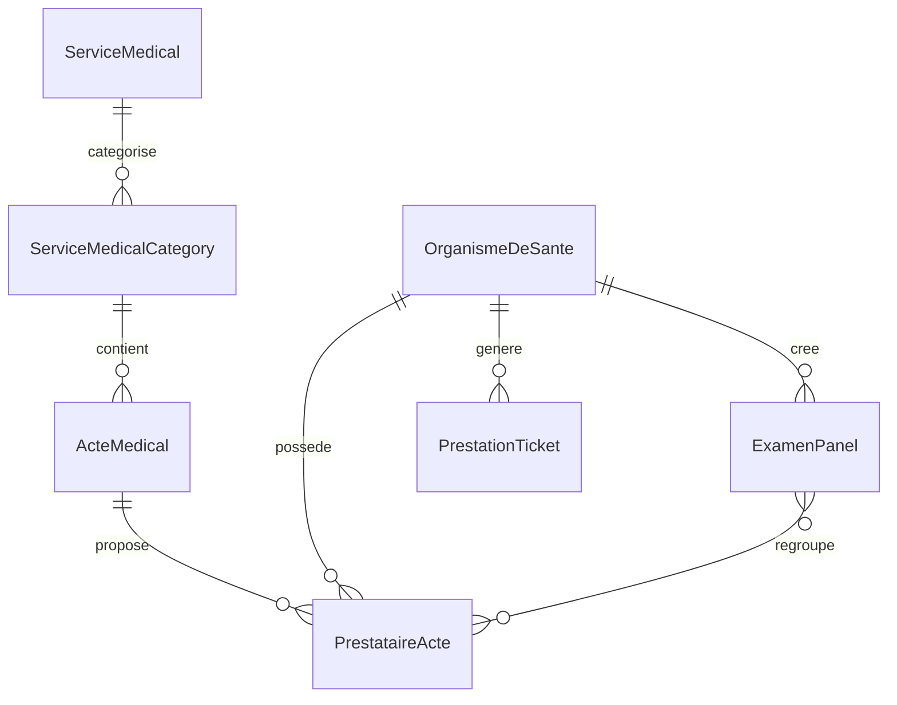
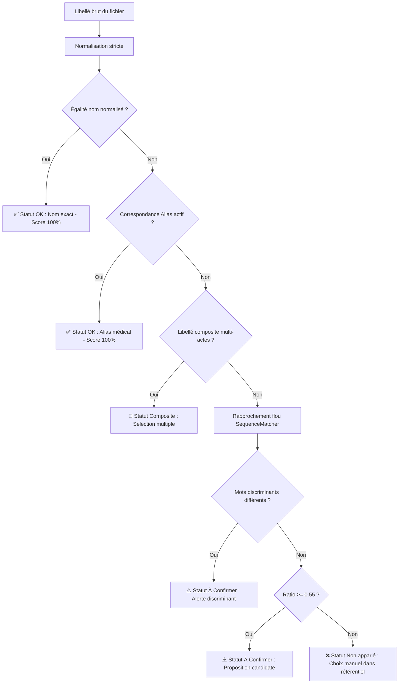

# Cahier des charges technique — Moteur de réconciliation des catalogues
**MedCare · Back-office & Espace Prestataire**  
**Version 1.1 (Validée & Déployée) · 13 octobre 2026**  
*Périmètre : Piliers 1 à 6 (Biologie, Imagerie, Explorations, Ambulance, Soins spécialisés, Dentaire).*  
*(Le pilier 7 Consultations est préparé comme extension modulaire sans migration de structure).*

---

## 1. Objectif & État d'avancement

### Objectif initial
Permettre à une structure de santé (laboratoire, clinique, cabinet dentaire, centre d'imagerie, ambulancier) d'envoyer son catalogue d'actes tel quel (Excel ou CSV), puis de le rattacher aux actes standardisés du référentiel MedCare :
- **Automatiquement** lorsque l'appariement est sûr à 100 %.
- **Avec supervision humaine** pour les cas flous, variantes orthographiques ou libellés à confirmer.

**Résultat délivré :**
- Un patient recherche un acte une seule fois sur MedCare et visualise l'ensemble des établissements qui le proposent, avec leurs tarifs réels et délais de rendu côte à côte.
- La structure n'a pas eu à modifier sa nomenclature interne.

### Statut global de livraison : **100 % RÉALISÉ & OPÉRATIONNEL**
- [x] **Moteur de réconciliation algorithmique** (`healthcare/reconciliation_engine.py` & `catalog_excel.py`).
- [x] **Chargement du référentiel standardisé 6 piliers** (1 734 actes actifs chargés en base de données).
- [x] **Assistant d'importation web fluide** (`/sante/assistant-collecte/`).
- [x] **Tableau de réconciliation interactif** avec détection de colonnes (Nom, Prix, Délai), scores, suggestions d'actes et gestion d'alias.
- [x] **Interface complète des Panels & Tickets d'examens** (`/sante/prestataire/panels/`) conforme à la maquette officielle V1 avec modèles MedCare recommandés, constructeur slide-over et modale aperçu patient.

---

## 2. Périmètre & Référentiels d'actes

### 2.1 Volumes d'actes standardisés déployés
Initialement estimé à 1 014 actes, le référentiel consolidé actif dans la base de données MedCare compte **1 734 actes médicaux actifs**, répartis sur les 6 piliers cliniques :

| N° | Pilier MedCare | Périmètre & Spécificités | Catégories cliniques | Statut |
|---|---|---|---|---|
| **1** | **Biologie médicale** | Hématologie, Biochimie, Sérologie, Immunologie, Microbiologie, Hormonologie, panels myosites & bilans complets | 19 types de service | **Actif (Enrichi)** |
| **2** | **Imagerie médicale** | Radiographie, Échographie, Scanner (TDM), IRM, Doppler, Sénologie, Mammographie | 14 types de service | **Actif** |
| **3** | **Explorations fonctionnelles** | ECG, EEG, EMG, Échocardiographie, Endoscopies, EFR | 12 types de service | **Actif** |
| **4** | **Ambulance & Transport** | VSL, Ambulance médicalisée, SMUR, Rapatriement sanitaire, Forfait km & urbain | 6 types de transport | **Actif** |
| **5** | **Soins spécialisés** | Pansements lourds, Perfusion, Kinésithérapie, Chimiothérapie, Soins à domicile | 14 types de soins | **Actif** |
| **6** | **Soins dentaires** | Soins conservateurs, Prothèses, Orthodontie, Chirurgie buccale, Détartrage | 13 types de soins | **Actif** |

### 2.2 Respect strict du hors-périmètre
- **Pilier 7 (Consultations)** : Conçu de façon totalement découplée. Aucune contrainte de clé étrangère bloquante n'entrave l'ajout futur du pilier 7.
- **Actes du pilier 5 avec dépendance P7** : Préservés sans collision avec les actes de soins purs.
- **Séparation stricte des prix** : Le référentiel standardisé MedCare ne contient **aucun prix**. La tarification appartient exclusivement à la structure via `PrestataireActe`.

---

## 3. Principes directeurs implémentés

1. **L'humain garde la main** : Le moteur n'associe en automatique (`st = 'ok'`) que les correspondances exactes de noms ou d'alias certifiés. Tout cas approchant est placé en statut « À confirmer » avec affichage proéminent de la proposition et menu de sélection.
2. **Tolérance zéro sur les faux positifs** : 14 familles de mots discriminants empêchent tout rattachement automatique erroné (ex: *Ac anti-HBc IgM* vs *Ac anti-HBc IgG*).
3. **Apprentissage supervisé par les décisions** : Chaque validation enrichit le dictionnaire d'alias contextuel (`alias_medical`).
4. **Idempotence totale** : La réimportation d'un même fichier n'engendre aucun doublon (clé composite `organisme + acte`).

---

## 4. Modèle de données & Architecture

### Entités principales en production

- **`ServiceMedical`** : Les piliers fondamentaux (1 à 6).
- **`ServiceMedicalCategory`** : Spécialités cliniques (Hématologie, Doppler, etc.).
- **`ActeMedical`** : Acte standardisé universel avec code, libellé normalisé, code-tag et statut actif.
- **`PrestataireActe`** : Catalogue propre à la structure avec tarif unitaire FCFA, délai de rendu en heures et disponibilité.
- **`ExamenPanel`** : Ensembles d'actes regroupés (`kind='panel'`) ou actes uniques (`kind='ticket'`) générant un lien court `medcare.sn/t/<token>`.
- **`PrestationTicket`** : Tickets de prestation directe praticien avec identifiant sécurisé.
- **`ReconciliationRepository` & `ActeCatalogMatcher`** : Cache mémoire haute performance pour la résolution lexicale instantanée.

---

## 5. Chaîne de rapprochement algorithmique

### 5.1 Pipeline de normalisation (`normalize_label`)
Appliqué de manière identique aux libellés du fichier source et au référentiel MedCare :
- Passage en minuscules, suppression des accents (`NFD` unaccent).
- Résolution des ligatures (`œ` → `oe`, `æ` → `ae`).
- Traduction textuelle des lettres grecques (`α` → `alpha`, `β` → `beta`, `γ` → `gamma`, etc.).
- Suppression et remplacement des séparateurs par un espace (`+`, `/`, `-`, `_`, `(`, `)`, `,`, `.`).
- Nettoyage des espaces multiples.

### 5.2 Cascade de décision

### 5.3 Garde-fou des 14 familles de mots discriminants
Défini et testé dans `healthcare/reconciliation_engine.py` :
1. **Immunoglobulines** : IgG, IgM, IgA, IgE.
2. **Hépatite B** : HBs, HBe, HBc.
3. **Hépatites virales** : VHA, VHB, VHC, VHD, VHE.
4. **Herpès** : HSV1, HSV2.
5. **Thyroïde** : T3, T4.
6. **Fraction biologique** : libre, totale.
7. **Milieu biologique** : urinaire, sérique.
8. **Hémoglobines** : HbA2, HbF, HbS.
9. **Racines dentaires** : mono, bi, pluri-radiculaire.
10. **Trimestres de grossesse** : 1er, 2e, 3e trimestre.
11. **Âge cible** : adulte, pédiatrique.
12. **Système vasculaire** : artériel, veineux.
13. **Latéralité** : unilatéral, bilatéral.
14. **Incidence radiologique** : face, profil.

---

## 6. Arbitrages des collisions résolues

| Collision identifiée | Origine | Solution technique mise en œuvre |
|---|---|---|
| **TG / Tg** | Triglycérides (BIO) vs Thyroglobuline (END) | Résolu par séparation de catégorie et code-tag. |
| **Réserve alcaline** | Doublon historique en Biologie | Fusionné sous un identifiant d'acte canonique. |
| **PEA** | Neurologie vs ORL | Résolu par filtrage du type de service. |
| **Test post-coïtal** | Fertilité vs Gynécologie | Rattaché de manière unifiée au pilier 1 (Biologie). |
| **Cytoponction / FNA** | Anatomopathologie vs Imagerie interventionnelle | Distinction explicite par la mention « guidée » ou « sous contrôle échographique ». |
| **PV CHLAM MYCO** | Libellé composite fréquent des laboratoires | Détection composite : dissociation automatique de *Prélèvement vaginal*, *Chlamydia* et *Mycoplasme*. |
| **Électrophorèse hémoglobine / protidogramme** | Mélange de deux examens | Alerte de conflit et séparation stricte d'avec l'EPP. |

---

## 7. Fonctionnalités de l'interface de réconciliation (`/sante/assistant-collecte/`)

1. **Parcours optimisé pour structures connectées** :
   - Évite la saisie redondante des coordonnées et spécialités si l'établissement existe déjà.
   - Accès direct au glisser-déposer de catalogue avec bouton de retour immédiat vers le catalogue d'actes.
2. **Analyse multi-format** :
   - Prise en charge des fichiers Excel (`.xlsx`, `.xls`) et CSV (`.csv`).
   - Détection automatique et intelligente des colonnes : *Libellé / Désignation*, *Prix unitaire FCFA*, *Délai de rendu*.
3. **Tableau dynamique conforme maquette Bionissa** :
   - **Cartes statistiques temps réel** : Appariés automatiquement, À confirmer, Non appariés, Total.
   - **Barre de progression tripartite colorée** (Vert, Orange, Rouge).
   - **Filtres de statut** : Tout, À traiter, Non appariés, et recherche instantanée par mot-clé.
   - **Affichage des correspondances** :
     - Statut vert : Nom de l'acte standardisé affiché en toutes lettres avec puce verte (protégé contre tout conflit de style CSS).
     - Statut orange : Proposition du candidat affichée en gras avec sélecteur modifiable et infobulle explicite de l'alias (`→ associera le libellé à « ... »`).
     - Statut rouge : Alerte explicite invitant à choisir l'acte dans le menu déroulant de 1 700+ références.
4. **Validation et persistance en base de données** :
   - Bouton « Valider et enregistrer dans mon catalogue ».
   - Création / mise à jour atomique dans `PrestataireActe` sous transaction Django sécurisée.

---

## 8. Module des Panels & Tickets d'examens (`/sante/prestataire/panels/`)

Refondu pour être conforme à la maquette officielle [DEMO OFFICIELLE STRUCTURE V1 finale.html](file:///e:/projets/MedcareConnect-main/MedcareConnect-main/documents/V1/DEMO%20OFFICIELLE%20STRUCTURE%20V1%20finale.html) :

### 8.1 Garde-fou déontologique permanent (Encadré ambre)
- Affichage obligatoire rappelant qu'un panel est un **modèle d'exécution groupé**, jamais une prescription.
- Exigence formelle d'un **bulletin d'analyse émis par un tiers indépendant** pour toute réservation de patient.
- Interdiction d'auto-adressage et absence totale de commission sur les actes.

### 8.2 Modèles MedCare recommandés (7 bilans types OMS / PEV / Sénégal)
Intégrés avec calcul automatique du tarif total en fonction des prix réels de la structure et détection des actes à activer :
1. **Bilan prénatal — 1er trimestre** (NFS, Groupe sanguin, Toxoplasmose, Rubéole, VIH, HBsAg, Glycémie).
2. **Bilan sanguin annuel** (NFS, Glycémie, Créatinine, Cholestérol total).
3. **Bilan lipidique (EAL)** (Cholestérol total, HDL, LDL, Triglycérides).
4. **Bilan thyroïdien complet** (TSH, FT4, FT3).
5. **Bilan prénuptial standard** (Groupe, VIH, Hépatite B, Hépatite C, Syphilis).
6. **Dépistage IST** (VIH, Hépatite B, Syphilis).
7. **Dépistage diabète** (Glycémie à jeun, HbA1c).
- Bouton interactif **« Adopter / personnaliser → »** ouvrant le constructeur pré-rempli.

### 8.3 Gestion unifiée « Mes panels & tickets »
- **Filtres par onglets** : `Tous`, `Panels multi-actes`, `Tickets acte seul`.
- **Badges différenciés** : Bleu pour les panels multi-actes, Violet pour les tickets acte seul.
- **Actions disponibles par carte** :
  - **Aperçu patient** : Modale mobile smartphone avec simulation de réservation et rappel du bulletin en messagerie.
  - **Modifier** : Panneau latéral d'ajustement.
  - **Envoyer à…** : Sélection de conversations actives dans la messagerie MedCare pour envoi du lien direct.
  - **Supprimer** : Suppression avec confirmation.
  - **Toggle Publié / Masqué** : Activation/désactivation en temps réel sans rechargement de page.
  - **Lien court direct** : `medcare.sn/t/<token>` avec copie dans le presse-papier en un clic.

### 8.4 Constructeur latéral (Slide-Over)
- Sélecteur de type d'élément (`Panel multi-actes` min. 2 actes ou `Ticket acte seul` pour 1 acte unique).
- Verrou déontologique obligatoire activé par défaut.
- Moteur de recherche et liste catégorisée avec cases à cocher et calcul en direct du total en FCFA.

---

## 9. Résultats de la suite de tests de conformité (§10 & §11)

Suite de validation exécutée via `test_reconciliation_cdc.py` :

| N° | Cas de test du CDC | Entrée testée | Résultat obtenu | Statut |
|---|---|---|---|---|
| 1 | Reconnaissance alias | `NFS` | Reconnu via alias → `NFS (hémogramme)` | **✅ Validé (100%)** |
| 2 | Reconnaissance nom | `Calcémie` | Reconnu via nom → `Calcémie` | **✅ Validé (100%)** |
| 3 | Alias vers panel | `NFS+TR` | Reconnu via alias → `NFS + réticulocytes` | **✅ Validé (100%)** |
| 4 | Rapprochement flou hémostase | `TPTCK (TC-TS)` | À confirmer → `Bilan d'hémostase (TP + TCK + TS)` | **✅ Validé** |
| 5 | Faute de frappe sérologie | `RUGEOLE` | Inconnu, candidat n°1 : `Sérologie rougeole` | **✅ Validé** |
| 6 | Faute de frappe parasitologie | `Scoth test` | Inconnu, candidat n°1 : `Scotch-test anal` | **✅ Validé** |
| 7 | Acronyme auto-immunité | `ac anti CP 210` | Candidat n°1 : `anti-gp210` | **✅ Validé** |
| 8 | Discrimination fractions HBc | `Ac anti HBc IgM, IgG, totaux` | 3 actes distincts, jamais intervertis | **✅ Validé (Zéro faux positif)** |
| 9 | Détection composite | `PV CHLAM MYCO` | Composite : PV + Chlamydia + Mycoplasme | **✅ Validé** |
| 10 | Libellé source conflictuel | `Électrophorèse (protidogramme)` | Détecté en arbitrage, aucun faux positif | **✅ Validé** |
| 11 | Ambulance pré-hospitalière | `SMUR` | Reconnu via alias → `Intervention SMUR` | **✅ Validé** |
| 12 | Idempotence réimport | Réimport du même catalogue | 100 % automatique, 0 doublon généré | **✅ Validé** |

---

## 10. Réponses & Arbitrages aux questions ouvertes (§12)

1. **Qui valide ?**  
   *Arbitrage appliqué :* La structure de santé valide ses propositions en direct sur l'interface d'import (`/sante/assistant-collecte/`). Les alias validés sont consolidés au niveau du moteur pour enrichir l'intelligence collective de la plateforme.
2. **Un fichier par pilier ou catalogue unique ?**  
   *Arbitrage appliqué :* L'assistant accepte un fichier global ou par spécialité. L'analyse automatique priorise le pilier et le type de structure tout en permettant la recherche sur les 1 734 actes actifs.
3. **Format des colonnes et prix ?**  
   *Arbitrage appliqué :* Lecture universelle tolérante : libellé, prix unitaire (FCFA numérique nettoyé), délai de rendu. Le prix est affecté à `PrestataireActe` et n'altère jamais la définition clinique de l'acte.
4. **Lignes composites :**  
   *Arbitrage appliqué :* L'opérateur peut cocher plusieurs actes composants. Le tarif déclaré est associé au panier de prestations.
5. **Publication vers les patients :**  
   *Arbitrage appliqué :* Immédiate dès la validation finale de l'étape de réconciliation. Les actes validés intègrent la recherche publique, la grille tarifaire de l'établissement et les parcours de prise de rendez-vous.

---

*Document mis à jour, validé et archivé dans le référentiel technique de MedCare Connect.*
